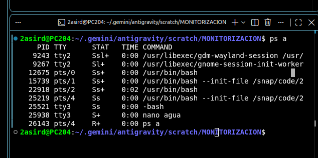
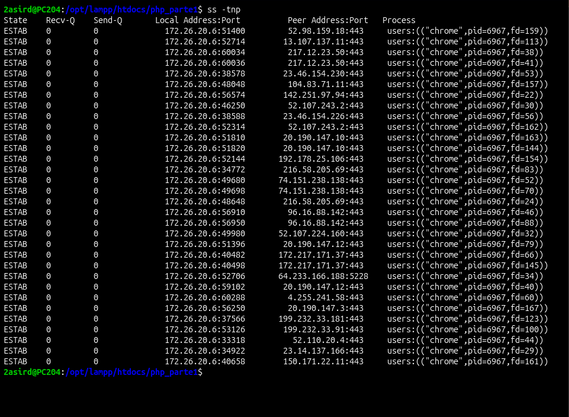
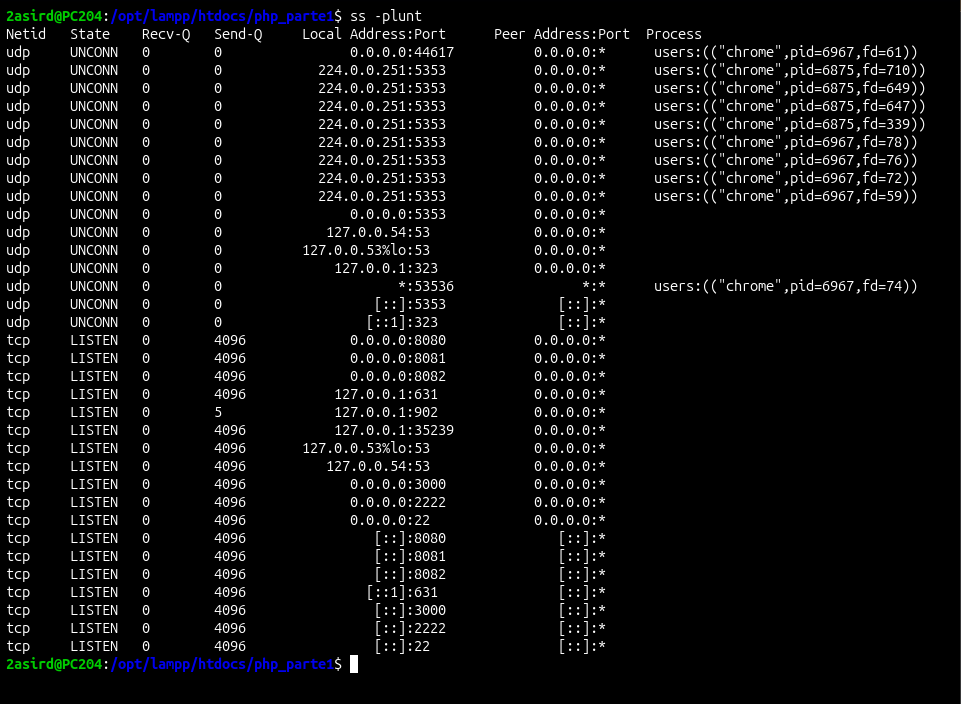
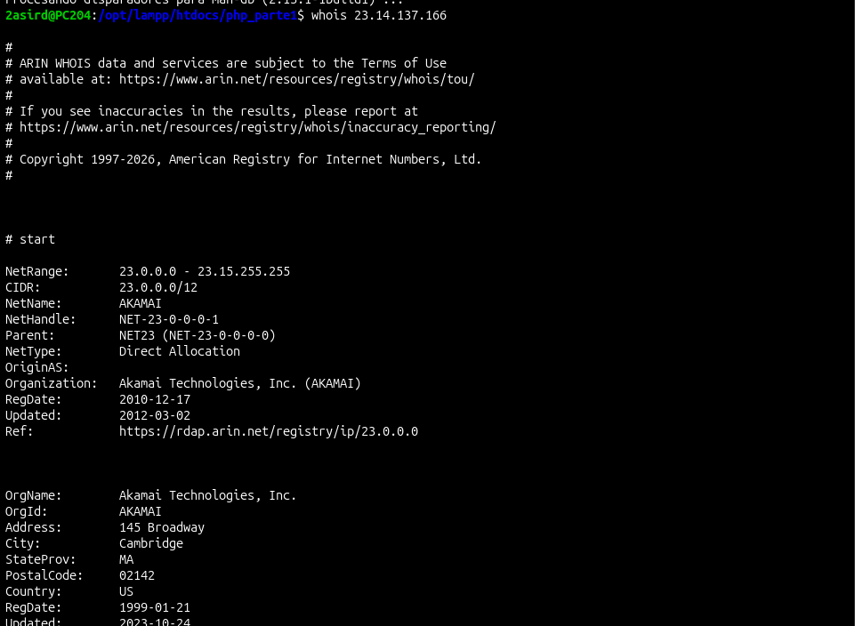

# 🖥️ Monitorización de Sistemas Linux

> Guía completa de comandos esenciales para monitorizar procesos, memoria, red y conexiones en sistemas Linux/Ubuntu.

---

## 📋 Tabla de Contenidos

- [🔍 1. Monitorización de Procesos](#-1-monitorización-de-procesos)
  - [ps a — procesos del terminal](#ps-a--procesos-del-terminal-activo)
  - [ps au — procesos con usuario](#ps-au--procesos-con-información-de-usuario)
  - [ps aux — todos los procesos](#ps-aux--todos-los-procesos-del-sistema)
  - [ps -C / ps u -C / ps -u — filtrar procesos](#ps--c--ps-u--c--ps--u--filtrar-procesos-por-nombre-o-usuario)
  - [top — monitor en tiempo real](#top--monitor-interactivo-en-tiempo-real)
  - [top -b -n 3 — exportar top](#top--b--n-3--exportar-top-a-fichero)
  - [htop — monitor avanzado](#htop--monitor-visual-avanzado)
- [💾 2. Monitorización de Memoria y Red](#-2-monitorización-de-memoria-y-red)
  - [free — uso de memoria RAM](#free--uso-de-la-memoria-ram)
  - [ss -tnp — conexiones TCP activas](#ss--tnp--conexiones-tcp-activas)
  - [ss -plunt — puertos en escucha](#ss--plunt--todos-los-puertos-en-escucha)
  - [nmap -sV — escaneo de versiones](#nmap--sv--escaneo-de-servicios-y-versiones)
  - [whois — información de IP](#whois--información-de-una-ip)
- [🌐 3. Monitorización de Red Local](#-3-monitorización-de-red-local)
  - [arp -n — tabla ARP](#arp--n--tabla-arp-de-la-red-local)

---

## 🔍 1. Monitorización de Procesos

### `ps a` — Procesos del terminal activo

Muestra los procesos asociados al terminal actual del usuario.

```bash
ps a
```

| Campo | Descripción |
|-------|-------------|
| `PID` | ID del proceso |
| `TTY` | Terminal asociado |
| `STAT` | Estado del proceso (`S`=sleep, `R`=running, `+`=foreground) |
| `TIME` | Tiempo de CPU consumido |
| `COMMAND` | Comando que lo lanzó |



> [!NOTE]
> `ps a` muestra procesos de **todos los terminales** (no solo el tuyo), pero solo los que tienen un terminal asociado.

---

### `ps au` — Procesos con información de usuario

Añade las columnas de usuario, CPU y memoria al listado anterior.

```bash
ps au
```

| Campo extra | Descripción |
|-------------|-------------|
| `USER` | Usuario propietario del proceso |
| `%CPU` | Porcentaje de CPU usado |
| `%MEM` | Porcentaje de RAM usada |
| `VSZ` | Memoria virtual (KB) |
| `RSS` | Memoria física real (KB) |
| `START` | Hora de inicio del proceso |


---

### `ps aux` — Todos los procesos del sistema

La combinación más completa: lista **absolutamente todos** los procesos del sistema.

```bash
ps aux
```

```bash
# Combinaciones útiles con ps aux:
ps aux | grep nginx          # buscar proceso concreto
ps aux --sort=-%mem          # ordenar por uso de memoria
ps aux --sort=-%cpu          # ordenar por uso de CPU
```


> [!TIP]
> Combina `ps aux` con `grep` para encontrar rápidamente cualquier proceso: `ps aux | grep <nombre>`

---

### `ps -C` / `ps u -C` / `ps -u` — Filtrar procesos por nombre o usuario

Tres variantes para localizar procesos específicos sin usar `grep`.

```bash
ps -C nano           # buscar por nombre de proceso
ps u -C nano         # igual, con detalle de usuario (USER, %CPU, %MEM…)
ps -u alumno         # todos los procesos de un usuario concreto
```

| Variante | Descripción |
|----------|-------------|
| `ps -C <nombre>` | Filtra por nombre de comando; devuelve PID, TTY, TIME, CMD |
| `ps u -C <nombre>` | Igual que el anterior pero añade USER, %CPU, %MEM, VSZ, RSS, STAT, START |
| `ps -u <usuario>` | Lista todos los procesos del usuario indicado |


> [!NOTE]
> En la captura se muestran los tres comandos: primero `ps -C nano` (solo PID y tiempo), luego `ps u -C nano` (con usuario y recursos) y finalmente `ps -u alumno` que lista todos los procesos de la sesión del usuario `alumno`.

---

### `top` — Monitor interactivo en tiempo real

Interfaz dinámica que actualiza continuamente el estado de procesos, CPU y memoria.

```bash
top
```

**Atajos de teclado dentro de `top`:**

| Tecla | Acción |
|-------|--------|
| `q` | Salir |
| `k` | Matar un proceso (introduce PID) |
| `M` | Ordenar por uso de memoria |
| `P` | Ordenar por uso de CPU |
| `u` | Filtrar por usuario |
| `1` | Ver CPUs individuales |
| `h` | Ayuda |


---

### `top -b -n 3` — Exportar top a fichero

Ejecuta `top` en modo batch (`-b`) durante `n` iteraciones y guarda la salida en un archivo.

```bash
top -b -n 3 > top.info
```

| Flag | Significado |
|------|-------------|
| `-b` | Modo batch (no interactivo, apto para redirigir) |
| `-n 3` | Número de iteraciones antes de salir |
| `> top.info` | Redirige la salida al fichero `top.info` |


> [!TIP]
> Ideal para registrar el estado del sistema periódicamente en scripts de cron.

---

### `htop` — Monitor visual avanzado

Versión mejorada y en color de `top`, con soporte de ratón y barras de progreso.

```bash
htop
```

**Vistas disponibles:**

| Vista | Descripción |
|-------|-------------|
| `Main` | Vista principal de procesos |
| `I/O` | Monitorización de operaciones de entrada/salida por proceso |

**Teclas de función:**

| Tecla | Acción |
|-------|--------|
| `F1` | Ayuda |
| `F3` | Buscar proceso |
| `F5` | Vista árbol de procesos |
| `F6` | Ordenar por columna |
| `F9` | Matar proceso |
| `F10` | Salir |


> [!NOTE]
> Si no tienes `htop` instalado: `sudo apt install htop`

---

## 💾 2. Monitorización de Memoria y Red

### `free` — Uso de la memoria RAM

Muestra el uso de memoria RAM y swap del sistema.

```bash
free        # en kilobytes
free -h     # formato legible (MB/GB)
free -c 3   # repite 3 veces
free -s 3   # refresca cada 3 segundos
```

| Columna | Descripción |
|---------|-------------|
| `total` | Memoria total instalada |
| `used` | Memoria en uso activo |
| `free` | Memoria completamente libre |
| `shared` | Usada por tmpfs |
| `buff/cache` | Usada por buffers/caché del kernel |
| `available` | Memoria disponible para nuevas aplicaciones |


> [!TIP]
> La columna `available` es más relevante que `free` para saber cuánta RAM puedes usar realmente.

---

### `ss -tnp` — Conexiones TCP activas

Muestra todas las conexiones TCP establecidas con el nombre del proceso asociado.

```bash
ss -tnp
```

| Flag | Significado |
|------|-------------|
| `-t` | Solo conexiones TCP |
| `-n` | Sin resolver nombres (muestra IPs y puertos numéricos) |
| `-p` | Muestra el proceso dueño de la conexión |



> [!NOTE]
> En la captura se aprecian múltiples conexiones `ESTAB` (establecidas) desde Chrome hacia servidores externos en el puerto 443 (HTTPS).

---

### `ss -plunt` — Todos los puertos en escucha

Lista todos los sockets en escucha, tanto TCP como UDP, con proceso y número de puerto.

```bash
ss -plunt
```

| Flag | Significado |
|------|-------------|
| `-p` | Muestra el proceso asociado |
| `-l` | Solo sockets en estado `LISTEN` |
| `-u` | Incluye UDP |
| `-n` | Sin resolución de nombres |
| `-t` | Incluye TCP |

**Puertos detectados en el sistema:**

| Puerto | Protocolo | Servicio |
|--------|-----------|----------|
| `8080`, `8081`, `8082` | TCP | Servidores web (LAMPP/Apache) |
| `3000` | TCP | Servidor de desarrollo |
| `2222` | TCP | SSH alternativo |
| `22` | TCP | SSH estándar |
| `631` | TCP | CUPS (impresión) |



---

### `nmap -sV` — Escaneo de servicios y versiones

Escanea un host remoto y detecta los servicios que tiene abiertos junto a su versión exacta.

```bash
nmap -sV 172.26.20.3
```

| Flag | Significado |
|------|-------------|
| `-sV` | Detecta versiones de los servicios |

**Resultado del escaneo sobre `172.26.20.3`:**

| Puerto | Estado | Servicio | Versión |
|--------|--------|----------|---------|
| `22/tcp` | open | ssh | OpenSSH 10.2p1 Ubuntu |
| `139/tcp` | open | netbios-ssn | Samba smbd 4 |
| `445/tcp` | open | netbios-ssn | Samba smbd 4 |


> [!WARNING]
> Usa `nmap` solo en redes donde tengas autorización. El escaneo no autorizado puede ser ilegal.

---

### `whois` — Información de una IP

Consulta la base de datos WHOIS para obtener información de registro de una dirección IP pública.

```bash
whois 23.14.137.166
```

**Datos obtenidos para `23.14.137.166`:**

| Campo | Valor |
|-------|-------|
| `NetRange` | 23.0.0.0 – 23.15.255.255 |
| `CIDR` | 23.0.0.0/12 |
| `NetName` | AKAMAI |
| `Organization` | Akamai Technologies, Inc. |
| `Country` | US |



> [!NOTE]
> Esta IP pertenece a **Akamai Technologies**, una CDN global. Aparece porque Chrome establece conexiones con servidores Akamai para cargar contenido web.

---

## 🌐 3. Monitorización de Red Local

### `arp -n` — Tabla ARP de la red local

Muestra la tabla ARP del sistema: la asociación entre direcciones IP y direcciones MAC de los equipos de la red local.

```bash
arp -n
```

| Flag | Significado |
|------|-------------|
| `-n` | Muestra direcciones numéricas (sin resolver hostnames) |

| Columna | Descripción |
|---------|-------------|
| `Dirección` | IP del equipo en la red |
| `TipoHW` | Tipo de hardware (`ether` = Ethernet) |
| `DirecciónHW` | Dirección MAC del equipo |
| `Indic` | Flags (`C` = Completo/válido) |
| `Interfaz` | Interfaz de red usada (`eno1`) |


> [!TIP]
> Las entradas marcadas como `(incompleto)` indican hosts que no respondieron al último ARP request. Las que tienen MAC visible (`C`) son dispositivos activos y accesibles.

```bash
# Ver solo los equipos activos (con MAC asignada):
arp -n | grep -v incompleto
```

---

## 📌 Resumen Rápido de Comandos

| Comando | Descripción |
|---------|-------------|
| `ps a` | Procesos del terminal activo |
| `ps au` | Procesos con info de usuario |
| `ps aux` | Todos los procesos del sistema |
| `ps -C <nombre>` | Buscar proceso por nombre de comando |
| `ps u -C <nombre>` | Proceso con detalle de usuario |
| `ps -u <usuario>` | Procesos de un usuario concreto |
| `top` | Monitor interactivo en tiempo real |
| `top -b -n N > file` | Exportar snapshot de top a fichero |
| `htop` | Monitor visual avanzado con I/O |
| `free -h` | Uso de RAM en formato legible |
| `free -s N` | Refresco continuo cada N segundos |
| `ss -tnp` | Conexiones TCP activas con proceso |
| `ss -plunt` | Todos los puertos en escucha |
| `nmap -sV <ip>` | Escaneo de servicios y versiones |
| `whois <ip>` | Info de registro de una IP |
| `arp -n` | Tabla ARP de la red local |

---

<div align="center">

**Sistema:** Ubuntu Linux &nbsp;|&nbsp; **Shell:** Bash &nbsp;|&nbsp; **Usuario:** 2asird@PC204

</div>
