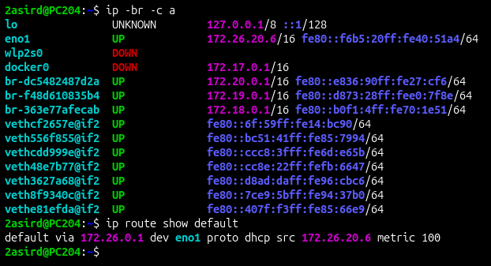

# Práctica: Análisis de red local
**ASIR - Herramientas y técnicas DevOps**  
**Unidad:** U3.- Monitorización  
**Sesión/práctica:** Análisis de red local  
**Alumno/a:** 2asird (PC204)  

---

## 1.- Identificar la configuración de red

### Comandos ejecutados:
```bash
ip -br -c a
ip route show default
```



### Respuestas:
1. **IP y la interfaz de red del equipo:**
   - **Interfaz:** `eno1`
   - **Dirección IP IPv4:** `172.26.20.6` (con prefijo `/16`)
   - *(IPv6 de enlace local: `fe80::f6b5:20ff:fe40:51a4/64`)*

2. **Puerta de enlace predeterminada:**
   - **Default Gateway:** `172.26.0.1` a través de la interfaz `eno1`.

3. **Dirección de red y su prefijo o máscara:**
   - **Prefijo:** `/16`
   - **Máscara de red:** `255.255.0.0`
   - **Dirección de red:** `172.26.0.0/16`

---

## 2.- Analizar y renovar una entrada ARP

### 1. IP del profesor y comprobación de red
- **IP del profesor:** `172.26.20.3`
- **Comprobación:** La IP de mi equipo es `172.26.20.6/16` y la del profesor es `172.26.20.3`. Puesto que la máscara es `/16` (`255.255.0.0`), la porción de red está compuesta por los dos primeros octetos (`172.26.x.x`). Ambas máquinas comparten la misma subred `172.26.0.0/16`, por lo que **sí está en la misma red local IPv4**.

---

### 2. Ejecución y función de los comandos ARP

#### Comandos:
```bash
arp -a
arp -n
ip neigh
```

#### Capturas:
- **Salida de `arp -a`:**  
  

- **Salida de `arp -n`:**  
  

#### ¿Qué hace cada comando?
- **`arp -a`**: Muestra la tabla de caché ARP (resolución de direcciones IP a MAC) intentando resolver mediante DNS inverso los nombres de host de las direcciones IP detectadas.
- **`arp -n`**: Muestra la tabla de caché ARP en formato puramente numérico (direcciones IP sin resolver a nombres de host), lo cual es considerablemente más rápido.
- **`ip neigh`**: Pertenece al paquete moderno `iproute2`. Muestra la tabla de vecinos (*neighbor cache*) tanto de IPv4 (ARP) como de IPv6 (NDP), indicando además el estado exacto de cada entrada (`REACHABLE`, `STALE`, `DELAY`, `FAILED`, etc.).

---

### 3. Preguntas sobre la tabla ARP

- **¿Qué MAC aparece asociada a la puerta de enlace (`172.26.0.1`)?**
  - **MAC de la puerta de enlace:** `64:62:66:25:50:b0` *(Host: `RodrigoCaroFW.rodrigocaro.fw`)*.

- **¿Por qué la tabla ARP no muestra todos los equipos de la red?**
  - La tabla ARP funciona **bajo demanda** (*on-demand*) y con tiempo de caducidad (*aging* o expiración). Un equipo únicamente almacena la dirección MAC de aquellos hosts con los que ha intercambiado tráfico directamente y de manera reciente. Los equipos inactivos o con los que no ha habido comunicación previa no se añaden a la caché para optimizar el consumo de memoria y mantener la tabla actualizada.

---

### 4. Generar y consultar la entrada del profesor

#### Comandos ejecutados:
```bash
ping -c 2 172.26.20.3
ip neigh show 172.26.20.3
```


- Tras lanzar el ping, el protocolo ARP resuelve la dirección física del profesor:
  - **IP:** `172.26.20.3`
  - **MAC:** `f4:b5:20:40:51:a6`
  - **Interfaz:** `eno1`
  - **Estado:** `DELAY`

---

### 5. Eliminar la asociación en el ordenador

#### Comando ejecutado:
```bash
sudo ip neigh del 172.26.20.3 dev eno1 && ip neigh show 172.26.20.3
```


- Al borrar la entrada de la tabla ARP con `ip neigh del`, la consulta inmediata posterior no devuelve ningún resultado, confirmando que la asociación ha sido eliminada con éxito de la caché local.

---

### 6. Regenerar la entrada ARP

#### Comandos ejecutados:
```bash
ping -c 2 172.26.20.3
ip neigh show 172.26.20.3
```


- Al volver a emitir tráfico hacia la IP del profesor (`ping`), el sistema vuelve a enviar una petición ARP (*ARP Request*) y recibe la respuesta (*ARP Reply*), almacenando de nuevo la entrada en estado `REACHABLE` con la MAC `f4:b5:20:40:51:a6`.

---

## 3.- Descubrir equipos con Nmap

### 1. Escaneo de red con la opción `-sn`

#### Comando ejecutado:
```bash
nmap -sn 172.26.20.0/24
```


- **Resultado:** Se han escaneado 256 direcciones IP y se han encontrado 2 hosts activos:
  - `172.26.20.3` (Máquina del profesor)
  - `172.26.20.6` (`PC204.local`, equipo propio)

---

### 2. ¿Qué hace exactamente la opción `-sn`?
- **Respuesta:** La opción `-sn` le indica a Nmap que realice un **escaneo de descubrimiento de hosts** (*Ping Scan / No port scan*). Su única función es determinar qué máquinas están encendidas y accesibles en la red sin realizar ningún análisis de puertos abiertos. En redes locales (Ethernet), utiliza peticiones ARP para realizar un descubrimiento muy rápido y discreto.

---

## 4.- Examinar puertos y servicios

### 1. Escaneo exclusivo a la máquina objetivo (`172.26.20.3`)

#### Comandos ejecutados:
```bash
nmap 172.26.20.3
nmap -sV 172.26.20.3
```


#### Puertos y servicios descubiertos:
| Puerto | Estado | Servicio | Versión detectada (`-sV`) |
| :--- | :--- | :--- | :--- |
| **22/tcp** | `open` | `ssh` | OpenSSH 10.2p1 Ubuntu 2ubuntu3.8 (Ubuntu Linux; protocol 2.0) |
| **139/tcp** | `open` | `netbios-ssn` | Samba smbd 4 |
| **445/tcp** | `open` | `microsoft-ds` | Samba smbd 4 |

- **Información del SO:** Linux (Kernel de Linux).

---

### 2. ¿Qué hace la opción `-sV`?
- **Respuesta:** La opción `-sV` activa la **detección de versión de los servicios** (*Service Version detection*). Una vez que Nmap detecta qué puertos TCP/UDP se encuentran abiertos, envía una serie de sondas (*probes*) específicas a cada puerto analizando los banners y respuestas que devuelven los demonios. De este modo, no solo indica el nombre genérico del servicio asociado al puerto por defecto, sino el software exacto que se está ejecutando (por ejemplo, `OpenSSH 10.2p1` o `Samba smbd 4`) y el sistema operativo anfitrión.
